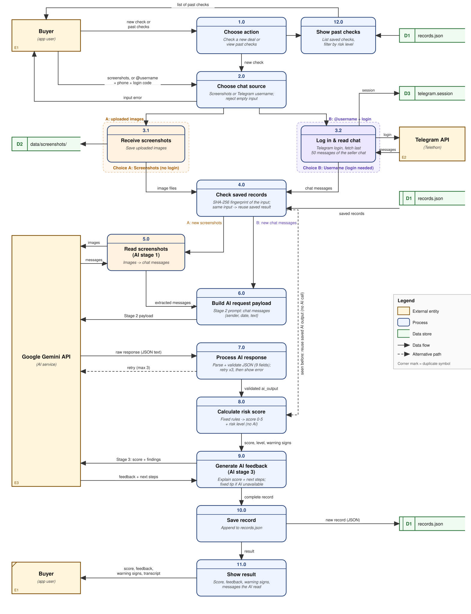

# Telegram Marketplace Risk Assessor

INF1103 Lab P3, Group 3

A tool that helps buyers on Telegram marketplaces check whether a deal looks like a scam. The buyer shares the chat with the seller, and the app returns a **risk score from 0 to 5**, the warning signs it found, and AI-written advice on what to do next.

## How it works

1. **Share the chat** in one of two ways:
   - **Screenshots (no login):** upload screenshots of the conversation. Only that conversation is shared.
   - **Telegram username (login needed):** log in once, and the app reads the last 50 messages of the seller chat.
2. **AI stage 1** (screenshots only): Gemini reads the screenshots and turns them into text messages.
3. **AI stage 2:** Gemini analyses the chat for scam warning signs. Every AI answer is checked against a JSON schema and retried up to 3 times if invalid.
4. **Risk score:** fixed rules in `logic_manager.py` turn the findings into a score from 0 to 5 (0-1 Low, 2-3 Medium, 4-5 High). No AI is used here, so the same chat always gets the same score.
5. **AI stage 3:** Gemini explains the score and suggests next steps. If this call fails, a fixed tip is shown instead.
6. **Save:** each check is saved to `data/records.json`. Checking the same input again reuses the saved result instead of calling the AI.

## Data flow diagram



The buyer first chooses a new check or past checks, then shares the chat as screenshots (Choice A) or by Telegram username (Choice B). Both paths meet at the saved-records check, then share one pipeline: AI analysis, rule-based score, AI feedback, save, show result.

## Project structure

| File | Role |
|---|---|
| `io_manager.py` | All user input and output for the CLI, Telegram chat reading, screenshot file handling |
| `ai_manager.py` | The three Gemini stages, JSON validation and retries |
| `logic_manager.py` | Rule-based risk score (0-5) and risk level |
| `data_manager.py` | Saving and loading `data/records.json`, input fingerprints, history filter |
| `main.py` | Command-line app (menu) |
| `app.py` | Streamlit web app |
| `test_logic_manager.py` | Automated tests (no API needed) |

The code is fully procedural: no classes are used.

## Setup

Copy `.env.example` to `.env` and fill in your keys:

```
GEMINI_API_KEY=your-gemini-key
TELEGRAM_API_ID=your-telegram-api-id
TELEGRAM_API_HASH=your-telegram-api-hash
```

The Telegram keys come from https://my.telegram.org (API development tools). They are only needed for username mode. `.env` is never committed or copied into the Docker image.

## Run with Docker

Build the image:

```
docker build -t risk-assessor .
```

**Web app** (default), then open http://localhost:8501:

```
docker run -p 8501:8501 --env-file .env -v "$(pwd)/data:/app/data" risk-assessor
```

**Command-line app:**

```
docker run -it --env-file .env -v "$(pwd)/data:/app/data" risk-assessor python main.py
```

The `-v` option keeps saved checks and the Telegram login in your local `data/` folder between runs.

## Run the tests

The tests use hardcoded sample AI answers, so they need no API key or internet connection.

```
docker run --rm risk-assessor python -m pytest -q
```

Or without Docker: `pip install -r requirements.txt`, then `python -m pytest -q`.

## Continuous integration

GitHub Actions (`.github/workflows/ci.yml`) runs on every pull request and every push to `main`. It builds the Docker image, checks all four managers import, runs the tests inside the container, and checks the web app starts.

## Data storage

| Path | Contents |
|---|---|
| `data/records.json` | Every completed check (input, chat messages, AI output, score, feedback) |
| `data/screenshots/` | Screenshots for the current check |
| `data/telegram.session` | Saved Telegram login |
| `data/app.log` | Warnings, such as failed AI attempts |
